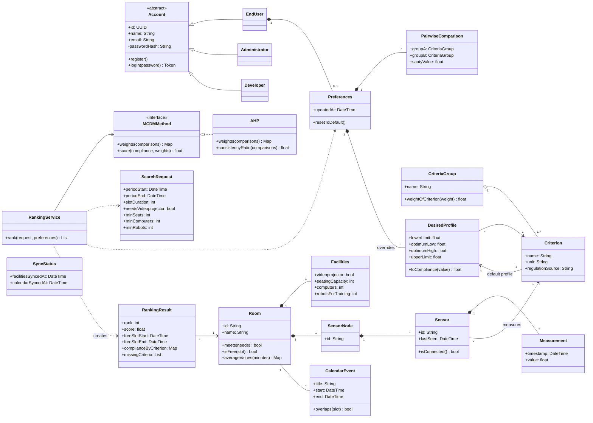

# Class Diagram — ComfortRoom

Draft for review. The diagram is written in Mermaid, so GitHub renders it directly.
After approval it will also be drawn in StarUML (`class-diagram.mdj` + PDF export), as in the reference project.

## Classes

| Class | What it represents | Use cases |
|---|---|---|
| `Account` | Common part of every account: name, e-mail, hashed password. Abstract. The subclass is the role (`EndUser`, `Administrator`, `Developer`). There is no separate role attribute. Use case 2 puts the subclass name in the JWT. | 1 Register, 2 Log In |
| `EndUser` | Student or teacher who searches for rooms and keeps preferences. | 3, 6 |
| `Administrator` | Monitors the system (UI2). | 9, 10, 11 |
| `Developer` | Uses the REST APIs. | 6, 9, 10, 12 |
| `Preferences` | Stored comparisons and profile overrides. A row exists only after a logged-in user saves. A guest, a new user, or a one-search change uses a working copy that is not stored. This class does not compute weights or the consistency ratio. `resetToDefault()` restores the default comparisons (air and thermal 3× acoustic and visual). | 3 Manage Preferences, 4, 5, 6 |
| `PairwiseComparison` | One answer on the Saaty scale between two criteria groups: "A is *x* times more important than B". | 4 Set Criteria Importance |
| `CriteriaGroup` | One of 4 groups: Thermal comfort, Air quality, Acoustic comfort, Visual comfort. Splits its weight equally among its criteria. The user compares groups, not single criteria. | 4 Set Criteria Importance |
| `DesiredProfile` | Four points of the trapezoid for one criterion: lower limit, optimum start, optimum end, upper limit. Compliance is 1 between the optimum points and 0 outside the outer limits. | 5 Adjust Desired Profile, 6 |
| `Criterion` | One thing the rooms are compared on (temperature, CO₂, …), its unit and the standard behind its default profile. | 4, 5, 6 |
| `Room` | A room of the building. `averageValues(30)` is the average of each quantity over the 30 minutes before the reference time (the latest measurement timestamp in the database). | 6, 8 |
| `Facilities` | Equipment of a room. Missing values = 0 / false. Used only to filter rooms, never in the score. | 7 Specify Needs, 8 |
| `SensorNode` | The Arduino of a room. It reads the sensors and sends the measurements. It does not compute the room score. | 13 |
| `Sensor` | One measured quantity in one room (e.g. CO₂ of Room_2). Disconnected if its last measurement is more than 5 minutes before the reference time. | 9, 11, 13 |
| `Measurement` | One value at one moment. | 9, 13 |
| `CalendarEvent` | A booking of a room from the university calendar. | 7, 10, 14 |
| `SearchRequest` | The needs of one search: period, slot length in minutes, required facilities. Not saved. Weights and profiles are not part of it. | 7 Specify Needs |
| `RankingService` | Runs the search: filter rooms by facilities and by the slot (occupancy only) → averages over the 30 minutes before the reference time → compliance → asks AHP for weights → score → ranking. If a criterion has no value, its weight is dropped and the rest are renormalized to 1. | 6 Find Suitable Room |
| `MCDMMethod` / `AHP` | The aggregation method. `AHP.weights` and `AHP.consistencyRatio` are the only place that turns pairwise comparisons into weights and a consistency ratio. The interface also exposes `score`, so another method (e.g. TOPSIS) can replace AHP. | 4, 6 |
| `RankingResult` | Score and rank of one room, the free slot that was found, compliance per criterion, criteria without data. | 6 |
| `SyncStatus` | `facilitiesSyncedAt` and `calendarSyncedAt`, written separately and only after that source is stored. One object for the system. Use case 10 warns when `calendarSyncedAt` is older than 30 minutes. | 10, 14 |

## Relationships

| From | To | Kind | Multiplicity | Why |
|---|---|---|---|---|
| EndUser, Administrator, Developer | Account | generalisation | — | one login, different rights |
| EndUser | Preferences | composition | 1 — 0..1 | a stored row exists only after the user saves; a guest and a new user have none |
| Preferences | PairwiseComparison | composition | 1 — * | the Saaty answers belong to the preferences |
| Preferences | DesiredProfile | composition | 1 — * | only the profiles the user changed are stored |
| Criterion | DesiredProfile | association | 1 — 1 | the regulation profile of this criterion |
| DesiredProfile | Criterion | association | * — 1 | every profile, default or override, belongs to one criterion |
| CriteriaGroup | Criterion | aggregation | 1 — 1..* | hierarchical AHP: the user compares groups, not single criteria |
| Room | Facilities | composition | 1 — 1 | |
| Room | SensorNode | composition | 1 — 1 | one Arduino per room |
| SensorNode | Sensor | composition | 1 — * | |
| Sensor | Measurement | composition | 1 — * | one value per minute in the test data; gaps longer than 5 minutes are computed from these timestamps |
| Sensor | Criterion | association | * — 1 | what the sensor measures |
| Room | CalendarEvent | association | 1 — * | |
| AHP | MCDMMethod | realisation | — | method can be swapped |
| RankingResult | Room | association | * — 1 | |

## Key design decisions

1. **`Account` is the superclass of `EndUser`, `Administrator` and `Developer`.** The subclass is the role. There is no role attribute. Use case 2 puts the subclass name in the JWT.
2. **A `Preferences` row is stored only when the user saves.** Registration creates none. The class stores comparisons and profile overrides. It does not compute weights or the consistency ratio: that is `AHP` only. For every criterion the user did not override, the regulation profile of `Criterion` is used. A one-search change (guest, or API2 parameters) is a working copy and is not stored.
3. **A `Sensor` is one quantity in one room**, not one physical device. The air-quality device gives two sensors: PM2.5 and PM10. This matches the test data and makes "disconnected" checkable per quantity.
4. **`SearchRequest` is not saved** and holds only the time slot and the facility filters. A slot is in the past when its end is earlier than the reference time, not earlier than the wall clock. Weights and profiles stay in `Preferences`.
5. **Hierarchical AHP with 4 `CriteriaGroup`s.** The user answers 6 comparisons. The assignment example compares criteria (Temperature vs Light); this project compares groups so there are 6 pairs instead of 28. Inside a group the weight is split equally, so that example cannot be reproduced exactly. Default comparisons are not all 1: air quality and thermal comfort are equal, acoustic and visual comfort are equal, and each of the first two is 3× each of the last two. Group weights are 37.5% / 37.5% / 12.5% / 12.5%, and the matrix has CR = 0. Sound is then 12.5%, not equal to the whole air-quality group.
6. **The reference time is the latest measurement timestamp in the database.** `Room.averageValues(30)` is the 30 minutes before that time. **MVP limitation:** the slot is used only to test occupancy; it does not change the score. Possible improvement: a window of the same hour of day. A missing criterion is dropped and the remaining weights are renormalized to 1.
7. **`MCDMMethod` is an interface.** The assignment suggests AHP and also mentions TOPSIS. The rest of the system does not change if the method changes.
8. **Facilities that a room does not list are 0 / false**, because the test file leaves them out. Facilities filter rooms and do not enter the score.
9. **`SensorNode` is the Arduino of the room.** It reads the sensors and sends the measurements (use case 13). The room score is computed by `RankingService`. Disconnection periods are computed from `Measurement` timestamps, so they have no class of their own.

## Resolved questions

- Facility criteria stay out of the score. Projector, seats, computers and robots are filters.
- `Developer` stays a subclass of `Account`: an account is required for API1. API2 is public.
- `SensorNode` stays. The Arduino is what produces the measurements. Its unused `lastSeen` field was removed; each `Sensor` has its own `lastSeen`.
